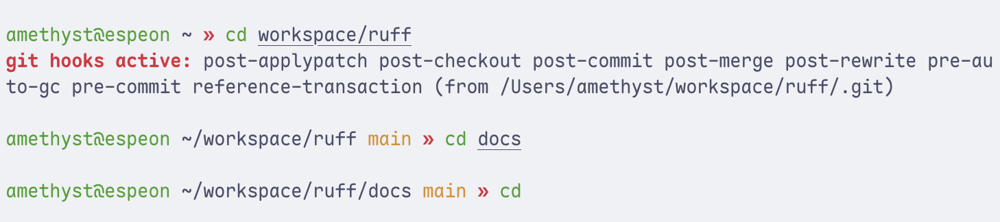
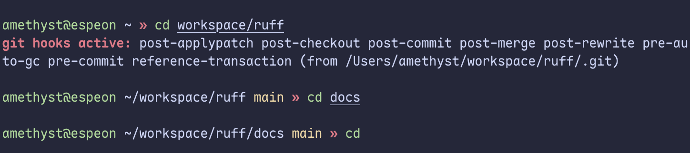

# zsh-announce-git-hooks

Make it obvious when you enter a directory with active git hooks.

Adapted from [Ned Batchelder's blog post](https://nedbatchelder.com/blog/202610/making_git_hooks_visible):

> Frank Wiles wrote about an attack he nearly fell victim to: a downloaded git
> repo had active git hooks that would have compromised his system. Seeing the
> risks, I wanted to make git hooks more visible on my own machine.

> The attack Frank saw was dangerous because it wasn’t a cloned repo: it was
> a local checkout that had hooks installed then shared as a Dropbox folder.
> So when it landed on Frank’s machine, the hooks were active without him
> realizing it.

Example in use:

# License

Copyright [Ned Batchelder](https://nedbatchelder.com).

Licensed under [Creative Commons CC BY-NC-SA 4.0](https://creativecommons.org/licenses/by-nc-sa/4.0/).
